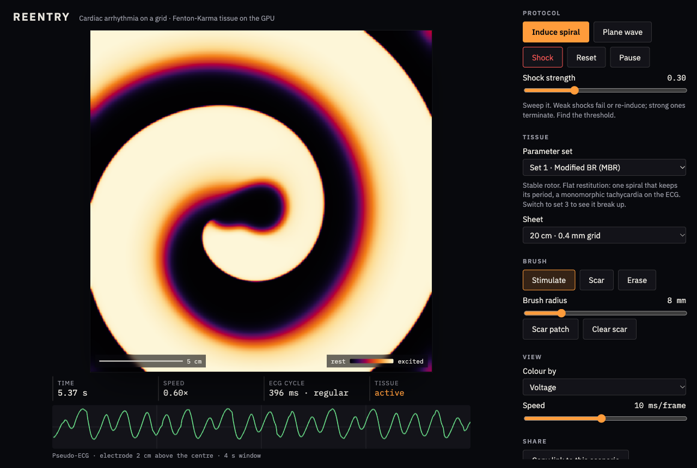

# Reentry

**Cardiac arrhythmia on a grid.** A three-variable Fenton-Karma model of heart muscle, solved on the GPU in your browser. Induce a spiral wave the way a ventricular tachycardia starts, watch it break up into fibrillation, paint scar and see the rotor anchor to it, then try to defibrillate.

**Live:** https://27jackson08.github.io/reentry/



## What you are looking at

A 20 cm square of simulated ventricular tissue, 512 cells on a side. Colour is membrane voltage: black is resting, pale is depolarized. Every frame the GPU advances the model by several time steps; a step is 0.1 ms of simulated time.

1. **Induce spiral.** An S1 stimulus launches a plane wave from the left edge. When that wave's tail reaches the middle of the sheet, an S2 stimulus fires into the lower-left quadrant. Half of S2's front runs into tissue that is still refractory and dies; the other half propagates. The free end curls into a rotor. This cross-field S1-S2 protocol is how reentry is started in real experiments.
2. **Watch.** The default set (modified Beeler-Reuter) holds a single stable rotor: a monomorphic tachycardia. The instrument strip says so: ECG cycle about 395 ms and regular, Rotors 1, with a ring drawn on the rotor tip. Switch to set 3, the original Beeler-Reuter fit, and the rotor breaks up into fibrillation; the ECG turns irregular and the rotor count climbs past ten.
3. **Scar.** Switch the brush to Scar and paint, or press _Scar patch_. Scar does not conduct. A rotor that wanders will anchor to it and turn around it.
4. **Shock.** A uniform current pulse across the whole sheet. Sweep the strength: weak shocks fail or re-induce, strong ones terminate. Find the threshold.
5. **Share.** The link encodes preset, grid, view and your scar strokes.

**Scenarios to open directly**

|                                                    |                                                                |
| -------------------------------------------------- | -------------------------------------------------------------- |
| Stable rotor, regular tachycardia                  | https://27jackson08.github.io/reentry/                         |
| Breakup into fibrillation (original Beeler-Reuter) | https://27jackson08.github.io/reentry/?preset=set3             |
| Rotor anchored to a scar patch                     | https://27jackson08.github.io/reentry/?scar=ZmgAM              |
| Phase view of a fast guinea-pig rotor              | https://27jackson08.github.io/reentry/?preset=set10&view=phase |
| Reference grid spacing of the papers (13 cm sheet) | https://27jackson08.github.io/reentry/?n=512&dx=0.025          |

Keyboard: `I` induce, `W` plane wave, `S` shock, `P` pace, `R` reset, `space` pause. Click the tissue to stimulate a spot. A fresh link induces a spiral on its own after a moment (not under reduced-motion settings).

## Results

Three experiments run by script against the deployed model, with figures, CSVs and discussion in [docs/RESULTS.md](docs/RESULTS.md).


- **Critical mass.** Garrey's 1914 observation in model form: the breakup sets (3, 8) need about 18 cm of tissue, roughly two wavelengths, to keep fibrillating; survival rises monotonically with size below that. The short-wavelength sets (1, 10) hold a rotor on a 5 cm sheet.
- **Defibrillation threshold.** A sharp step at an amplitude of 0.035, the same for a stable rotor and for fibrillation and independent of timing, and exactly the current that lifts resting tissue to its excitation threshold in 5 ms. In a monodomain model the defibrillation threshold is the pacing threshold, which is the clearest statement of what the model leaves out.
- **Antitachycardia pacing.** Entrains and resets both free and scar-anchored reentry in every one of 40 conditions, and terminates none: the excitable gap in homogeneous tissue is too wide. The success case needs a slow-conduction isthmus, which is the obvious next experiment.

## The science

The model is Fenton & Karma (1998). Three variables per cell: a voltage and two gates. Three currents: fast inward, slow outward, slow inward. It is fit to reproduce action potential shape, restitution and conduction velocity of larger ionic models, and it produces the real phenomenology: spiral waves, breakup, anchoring, defibrillation thresholds.

Parameter sets are Table I of Fenton, Cherry, Hastings & Evans (2002) plus MLR-I from 1998, with sources and the three transcription discrepancies recorded in [docs/PHYSICS.md](docs/PHYSICS.md). Every set's APD90, conduction velocity and restitution curve, measured on this implementation, are in [docs/validation.md](docs/validation.md).

What is checked, automatically:

- The GPU shader and a TypeScript reference solver agree cell for cell (Playwright, headless WebGL).
- Rest is a fixed point; threshold behaviour; APD restitution is monotone; conduction velocity is physiological; scar blocks conduction; a closed no-flux boundary leaks nothing.
- S1-S2 produces sustained reentry; a strong shock ends it; a weak one does not.
- The ECG rhythm readout recovers the period of a regular signal and stays quiet on a flat one.
- The rotor detector finds exactly one phase singularity in a synthetic spiral, two of opposite charge in a pair, none in uniform tissue, and merges the spurious clusters a coarse grid produces.
- With fibre anisotropy the GPU and CPU solvers still agree, and conduction is faster along fibres than across by about the square root of the conductivity ratio.
- Pacing bursts land on the exact time step and stop after the last beat.

What is simplified, deliberately: a flat sheet with at most a uniform fibre direction, no anatomy, a monodomain shock, and a default grid spacing 60 % coarser than the papers' (costing about 7 % in conduction velocity, documented in the physics notes, with the reference spacing one click away).

## Running it

```sh
npm install
npm run dev          # http://localhost:5173
npm test             # unit tests (Vitest)
npm run test:e2e     # Playwright, needs: npx playwright install chromium
npm run validate     # regenerates docs/validation.md (slow)
npm run build        # dist/
```

Requires WebGL2 with `EXT_color_buffer_float` (every desktop browser; iOS 15+).

## Layout

```
src/model/      Fenton-Karma equations, presets, CPU reference solver, measures
src/gpu/        WebGL2 context, textures, step/render/probe shaders, Simulation
src/protocol/   S1-S2 state machine, scar strokes, probe statistics
src/ecg/        pseudo-ECG and the scope renderer
src/app/        AppController: ties simulation, protocol, probe and ECG together
src/ui/         controls, pointer, keyboard
src/state/      URL state
tests/          Vitest unit tests;  e2e/  Playwright
docs/           PHYSICS.md, validation.md, screenshots
scripts/        survey and screenshot helpers
```

## References

- Fenton F, Karma A. Vortex dynamics in three-dimensional continuous myocardium with fiber rotation: filament instability and fibrillation. _Chaos_ 8:20 (1998). doi:10.1063/1.166311
- Fenton FH, Cherry EM, Hastings HM, Evans SJ. Multiple mechanisms of spiral wave breakup in a model of cardiac electrical activity. _Chaos_ 12:852 (2002). doi:10.1063/1.1504242
- Plonsey R, Barr RC. _Bioelectricity: A Quantitative Approach_, for the pseudo-ECG integral.

Companion projects: [Cardio-filter](https://github.com/27jackson08/Cardio-filter) (heart-sound filtering) and [Respira](https://github.com/27jackson08/Respira) (respiratory rate from PPG).

MIT licence.
